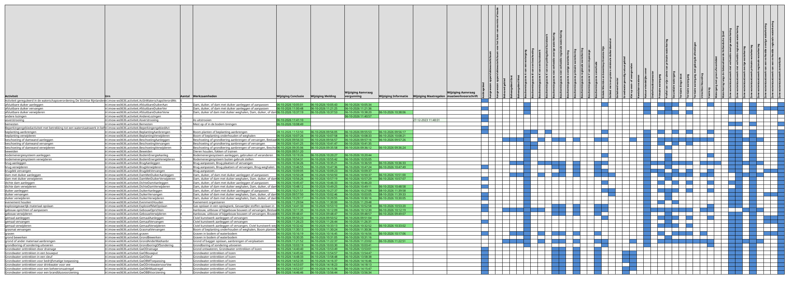

# Omgevingswet Archivering STTR

Een Python-tool voor het archiveren van de toepasbare regels uit de Registratie Toepasbare Regels (RTR) voor Nederlandse overheden.

## Overzicht

De tool leest de toepasbare regels van één bestuursorgaan op een peildatum en kan:

- Een Excel-overzicht genereren van alle activiteiten met hun werkzaamheden, de laatste wijziging per soort toepasbare regel en een matrix van de werkingsgebieden waarin elke activiteit geldt
- De STTR-bestanden (DMN XML) per activiteit downloaden en archiveren
- De werkingsgebieden met hun activiteiten exporteren



## Bron: geen API-key nodig

De gegevens komen uit de openbare achterkant van de RTR-viewer van het Omgevingsloket (`https://omgevingswet.overheid.nl/rtr-frontend/api`, en voor de pre-omgeving `https://pre.omgevingswet.overheid.nl/rtr-frontend/api`). Dat is precies wat iedere burger in het Omgevingsloket ziet. Er is geen API-key en er zijn geen PowerBI-exports nodig: de activiteiten worden gevonden door de activiteitenboom van het bestuursorgaan af te lopen, en de werkingsgebieden komen met hun naam rechtstreeks uit de RTR.

Dit is geen officieel gepubliceerde API met een ondersteuningsafspraak. De tool vraagt daarom rustig op: standaard 2 verzoeken per seconde (`--rate`). Een volledige run voor een waterschap duurt zo enkele minuten.

De RTR-client is overgenomen uit Knowledgebase-CLI (`sttr/rtr.py` en `sttr/catalogus.py`).

## Vereisten

- Python 3.9 of hoger
- `xlsxwriter`

## Setup

```bash
pip install -r requirements.txt
```

## Gebruik

```bash
python code/main.py
```

### Command-line opties

| Optie | Beschrijving | Standaard |
|-------|--------------|-----------|
| `--overheid` | Naam van het waterschap of de provincie (underscores voor spaties) | `Hoogheemraadschap_De_Stichtse_Rijnlanden` |
| `--oin` | OIN van het bestuursorgaan; nodig voor gemeenten, gaat voor `--overheid` | – |
| `--env` | Omgeving: `prod` of `pre` | `prod` |
| `--date` | Peildatum in formaat DD-MM-YYYY | Vandaag |
| `--sttr` | Download de STTR-bestanden (DMN XML) | Uit |
| `--location` | Exporteer de werkingsgebieden per activiteit | Uit |
| `--rate` | Verzoeken per seconde aan de RTR | `2` |
| `--include-t5` | Neem ook de `…T5`-varianten van activiteiten mee (die publiceren normaal geen STTR) | Uit |

### Welke overheden?

- **Waterschappen en provincies** worden op naam gevonden, bijvoorbeeld `--overheid Waterschap_Vechtstromen`, `--overheid Wetterskip_Fryslân` of `--overheid Provincie_Zuid-Holland`. Bij een onbekende naam toont de tool welke namen er wel zijn.
- **Gemeenten** geeft de RTR alleen op OIN prijs; gebruik `--oin`, bijvoorbeeld `--oin 00000001002220647000` (gemeente Utrecht). Het OIN staat in het OIN-register van Logius.

### Voorbeelden

Standaard uitvoering voor Hoogheemraadschap De Stichtse Rijnlanden:
```bash
python code/main.py
```

Voor een ander waterschap:
```bash
python code/main.py --overheid Waterschap_Vechtstromen
```

Pre-omgeving op een specifieke datum:
```bash
python code/main.py --env pre --date 03-03-2026
```

Volledig archief inclusief STTR-bestanden en werkingsgebieden:
```bash
python code/main.py --date 12-04-2025 --sttr --location
```

## Output

Alles komt in `log/`, met de peildatum, de naam van het bestuursorgaan en de omgeving in de naam:

- `…_STTR_status.xlsx`: één rij per activiteit, met
  - de werkzaamheden;
  - per soort toepasbare regel (Conclusie, Melding, Aanvraag vergunning, Informatie, Maatregelen, en een extra kolom voor elke andere soort die de RTR teruggeeft, zoals Aanvraag maatwerkvoorschrift) de laatste wijziging, groener naarmate die dichter vóór de peildatum ligt;
  - een blauwe cel voor elk werkingsgebied waarin de activiteit geldt. De kolomkoppen zijn de namen van de werkingsgebieden; het ambtsgebied staat vooraan als `Ambtsgebied`.
- `…_STTR_DMN-files/` (met `--sttr`): `STTR_<sttrId>_<activiteit>_<soort>.xml`, byte voor byte zoals gepubliceerd, plus `manifest.json` met per bestand de activiteit, soort, begindatum en laatste wijziging.
- `…_STTR_werkingsgebieden.txt` (met `--location`): per werkingsgebied de identificatie(s) en de activiteiten die er gelden.

## Tests

```bash
python -m unittest discover -s tests
```

## Projectstructuur

```
.
├── code/
│   ├── main.py          # Hoofdprogramma
│   ├── commands.py      # Command-line opties
│   ├── rtr.py           # Archivering: activiteiten lezen, outputs schrijven
│   ├── rtr_client.py    # Client voor de RTR (geen API-key)
│   ├── catalogus.py     # Bestuursorgaan vinden, activiteitenboom aflopen
│   ├── excel.py         # Excel-statusoverzicht
│   └── vertrouwen.py    # HTTPS op Windows met een nog onbekend root-certificaat
├── tests/
├── data/
│   └── xlsx_example.PNG
├── log/                 # Gegenereerde output (niet in git)
├── requirements.txt
└── README.md
```

## Licentie

Dit project is gelicenseerd onder de MIT License - zie het [LICENSE](LICENSE) bestand voor details.

## Bijdragen

Bijdragen zijn welkom! Zie [CONTRIBUTING.md](CONTRIBUTING.md) voor richtlijnen.
